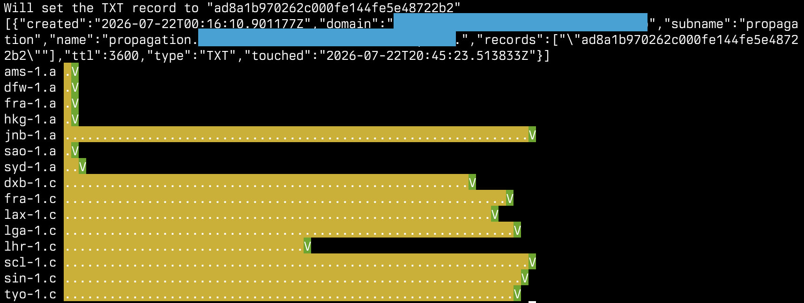

# deSEC change propagation monitor

This tool can be used to visually display propagation delays in the
[deSEC](https://desec.io) DNS network.

It creates a TXT record through the deSEC API, periodically (by
default, every 2 seconds) polls known deSEC servers and plots the resulting
responses as a timeline on the terminal. Its output looks something like this:



Each vertical column represents a 2-second time interval. A green `V` means
success, yellow blocks mean some intermediate state (missing record, multiple
records), red blocks mean errors (e.g. timeouts, refusals).

This is an unofficial tool, neither it nor its author are affiliated with deSEC.

Inspired by [desec-io/desec-debug](https://github.com/desec-io/desec-debug).

## Requirements

Python 3.11 or newer (because of `TaskGroup` and `except*`.

## How to use

```console
$ python3 -m venv venv
$ source venv/bin/activate
$ pip install -r requirements.txt
```

Set the following environment variables:

* `DESEC_TOKEN` - a token created at https://desec.io/tokens with enough
  permissions to modify the desired TXT RRset.
* `DESEC_DOMAIN` - the domain which will be used for testing.
* `DESEC_SUBNAME` - the subname/host to be used for testing. Set to `@` for
  apex.

For example, if you have the `example.com` domain registered with deSEC, and
you want to test with the `propagation.example.com`, set
`DESEC_DOMAIN=example.com` and `DESEC_SUBNAME=propagation`.

See `config.py` for other tweakable options.

Run the tool:

```console
$ python3 main.py
```

## Notes

`*.a.desec.io` and `*.b.desec.io` fetched from [desec-io/desec-debug](https://github.com/desec-io/desec-debug).

`*.b.desec.io` hosts have been commented out, since they don't seem to reply to external queries.

`*.c.desec.io` found through exploration.
